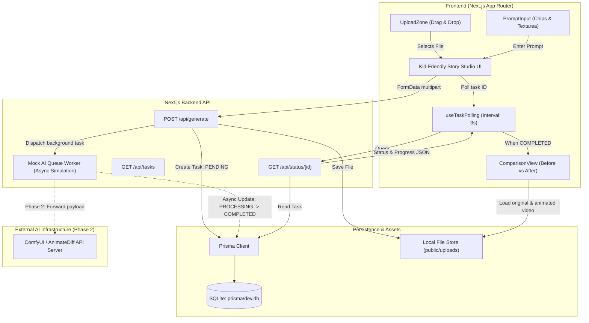

# Technical Architecture & System Design: AI Children's Story Animation Platform

**Document Version:** 1.0.0  
**Target Framework:** Next.js 14+ (App Router), TypeScript, SQLite, Prisma ORM  
**Status:** DRAFT - Pending Review

---

## 1. System Architecture Diagram



---

## 2. Directory & File Structure

```text
d:\mantage-video\
├── prisma\
│   ├── schema.prisma           # Prisma model definitions
│   └── dev.db                  # Local SQLite database instance
├── public\
│   ├── samples\                # Curated dummy animation outputs (.mp4 / animated .webp)
│   └── uploads\                # User uploaded images and static videos
├── src\
│   ├── app\
│   │   ├── api\
│   │   │   ├── generate\
│   │   │   │   └── route.ts    # POST /api/generate - Creates video animation task
│   │   │   ├── status\
│   │   │   │   └── [id]\
│   │   │   │       └── route.ts# GET /api/status/[id] - Polling endpoint
│   │   │   └── tasks\
│   │   │       └── route.ts    # GET /api/tasks - Retrieve recent creations
│   │   ├── favicon.ico
│   │   ├── globals.css         # Tailwind styles & kid-friendly animations
│   │   ├── layout.tsx          # Root layout with cheerful font & theme provider
│   │   └── page.tsx            # Main Story Studio Dashboard page
│   ├── components\
│   │   ├── Header.tsx          # Playful logo, title, and action badges
│   │   ├── UploadZone.tsx      # Drag & Drop file uploader with preview & clear
│   │   ├── PromptInput.tsx     # Creative prompt textarea with spark preset tags
│   │   ├── StatusProgress.tsx  # Animated progress bar, stage indicator, tips
│   │   ├── ComparisonView.tsx  # Side-by-side or slider comparison (Before/After)
│   │   └── RecentGallery.tsx   # Gallery drawer of past generation tasks
│   ├── hooks\
│   │   └── useTaskPolling.ts   # Custom React hook for robust 3-second polling
│   ├── lib\
│   │   ├── prisma.ts           # Global Prisma client singleton
│   │   ├── mockQueue.ts        # In-memory / background async simulation runner
│   │   └── types.ts            # Shared TypeScript interfaces & types
├── .env                        # Environment variables (DATABASE_URL="file:./dev.db")
├── .gitignore
├── next.config.mjs
├── package.json
├── postcss.config.mjs
├── tailwind.config.ts
├── tsconfig.json
├── SPEC.md                     # Product & functional specifications
└── ARCHITECTURE.md             # Technical design & API contracts
```

---

## 3. Data Modeling (Prisma Schema)

### `prisma/schema.prisma`

```prisma
datasource db {
  provider = "sqlite"
  url      = env("DATABASE_URL")
}

generator client {
  provider = "prisma-client-js"
}

enum TaskStatus {
  PENDING
  PROCESSING
  COMPLETED
  FAILED
}

model VideoTask {
  id              String      @id @default(cuid())
  userPrompt      String
  status          TaskStatus  @default(PENDING)
  progress        Int         @default(0)           // 0 to 100 percentage
  originalFileUrl String
  resultFileUrl   String?
  errorMessage    String?
  createdAt       DateTime    @default(now())
  updatedAt       DateTime    @updatedAt

  @@index([status])
  @@index([createdAt])
}
```

---

## 4. API Endpoints Specification

### 4.1 Create Animation Task
- **Endpoint:** `POST /api/generate`
- **Content-Type:** `multipart/form-data`
- **Request Fields:**
  - `file`: `File` (Image: `.png`, `.jpg`, `.jpeg`, `.webp` or Video: `.mp4`)
  - `prompt`: `string` (e.g., *"The smiling bunny hops through rainbow flowers"*)
- **Response `201 Created`:**
  ```json
  {
    "success": true,
    "task": {
      "id": "clx123abc456",
      "userPrompt": "The smiling bunny hops through rainbow flowers",
      "status": "PENDING",
      "progress": 0,
      "originalFileUrl": "/uploads/1700000000-bunny.png",
      "resultFileUrl": null,
      "createdAt": "2026-11-17T10:15:00.000Z"
    }
  }
  ```
- **Error Responses:**
  - `400 Bad Request`: Missing file or empty prompt.
  - `415 Unsupported Media Type`: Non-image/video format.
  - `500 Internal Server Error`: Disk write or DB persistence failure.

---

### 4.2 Check Task Status
- **Endpoint:** `GET /api/status/[id]`
- **Response `200 OK` (During Processing):**
  ```json
  {
    "id": "clx123abc456",
    "status": "PROCESSING",
    "progress": 65,
    "userPrompt": "The smiling bunny hops through rainbow flowers",
    "originalFileUrl": "/uploads/1700000000-bunny.png",
    "resultFileUrl": null,
    "statusMessage": "Animating character movements and camera pan...",
    "updatedAt": "2026-11-17T10:15:06.000Z"
  }
  ```
- **Response `200 OK` (Completed):**
  ```json
  {
    "id": "clx123abc456",
    "status": "COMPLETED",
    "progress": 100,
    "userPrompt": "The smiling bunny hops through rainbow flowers",
    "originalFileUrl": "/uploads/1700000000-bunny.png",
    "resultFileUrl": "/samples/animated-storybook-result.mp4",
    "statusMessage": "Your magical animation is ready!",
    "updatedAt": "2026-11-17T10:15:10.000Z"
  }
  ```
- **Error Response:**
  - `404 Not Found`: Task ID does not exist.

---

### 4.3 Task History & Recent Creations
- **Endpoint:** `GET /api/tasks?limit=10`
- **Response `200 OK`:** Array of recent `VideoTask` records ordered by `createdAt DESC`.

---

## 5. Queue Mocking & Simulation Logic

To simulate real-world AI processing (ComfyUI / AnimateDiff inference latency):
1. **Initiation (`t = 0s`):**  
   Task is saved as `PENDING`, progress = 0%. Asynchronous worker `simulateAiProcessing(taskId)` is launched without blocking the HTTP response.
2. **Phase 1 (`t = 2s`):**  
   Task transitions to `PROCESSING`, progress = 25%.  
   *Log / Message:* *"Analyzing character composition and story context..."*
3. **Phase 2 (`t = 5s`):**  
   Task remains `PROCESSING`, progress = 60%.  
   *Log / Message:* *"Generating fluid motion frames via AnimateDiff..."*
4. **Phase 3 (`t = 8s`):**  
   Task remains `PROCESSING`, progress = 85%.  
   *Log / Message:* *"Polishing animation and rendering audio sync..."*
5. **Phase 4 (`t = 10s`):**  
   Task transitions to `COMPLETED`, progress = 100%.  
   `resultFileUrl` is populated with a high-definition sample animated clip.

*Note for Phase 2 Production:* The `simulateAiProcessing` function serves as the drop-in boundary for a ComfyUI REST/WebSocket client or Celery/BullMQ worker.

---

## 6. Frontend State & Real-Time UX

- **Custom Polling Hook (`useTaskPolling`):**
  - Manages polling interval of 3000ms using `useRef` / `useEffect`.
  - Automatically cancels polling once status hits `COMPLETED` or `FAILED`.
  - Exposes `{ task, isPolling, error, reset }`.
- **Kid-Friendly Visual Feedback:**
  - Gradient shimmer progress bar.
  - Floating whimsical animations (lucide-react stars, sparkles, wand).
- **Comparison View:**
  - Split layout with synchronized video playback controls or toggle between "Original Scene" and "Magic Motion".
  - One-click MP4 download trigger.

---

## 7. Security & File Handling Strategy

1. **File Sanitization:** Random UUID/timestamp prefixing to prevent filename collisions (`1700000000-[random].png`).
2. **File Size Capping:** Capped at 25MB on both frontend and Next.js route handler.
3. **MIME Verification:** Whitelist check for `image/png`, `image/jpeg`, `image/webp`, `video/mp4`.
